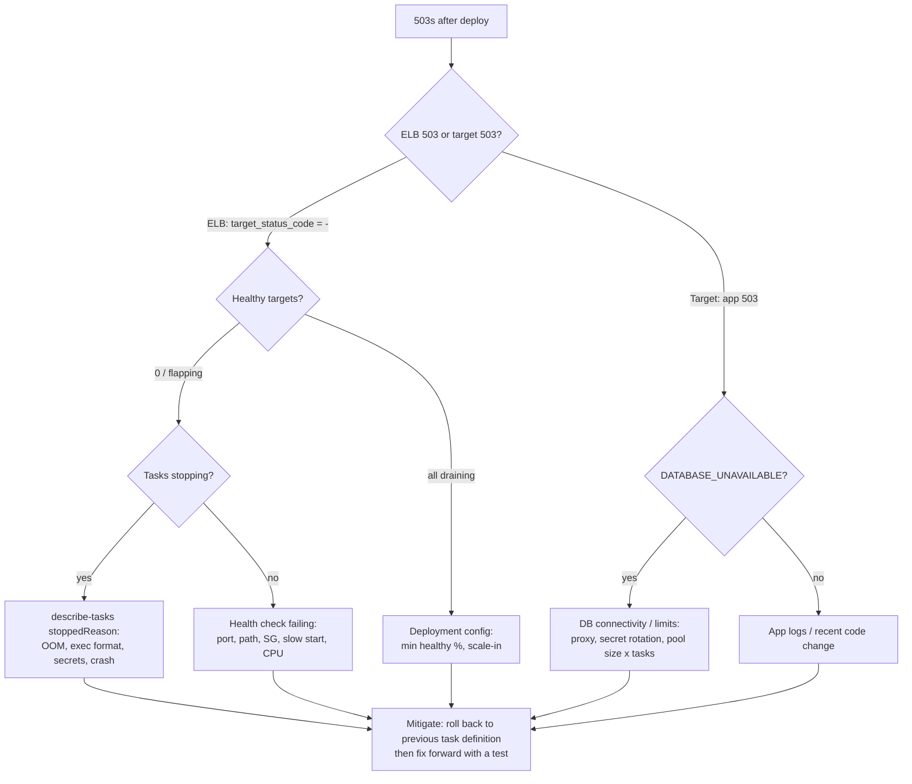

# Incident Response: Intermittent HTTP 503 After a Deployment

**Symptom:** after a new deployment users intermittently get `HTTP 503 Service
Unavailable`. The ALB itself is up.

## 0. What a 503 from this stack can mean

The status code alone narrows the search a lot:

| Response | Generated by | Usual meaning |
|---|---|---|
| **503 from the ALB** (`HTTPCode_ELB_503_Count`, access log `target_status_code = -`) | Load balancer | **No healthy targets** in the target group at that moment (all failing health checks, still in initial health checking, or draining), or the target group has no registered targets |
| **503 from the app** (`HTTPCode_Target_5XX_Count`, body `{"error":{"code":"DATABASE_UNAVAILABLE"}}`, `Retry-After: 5`) | Orders API | The task is fine but cannot get a DB connection in time (pool exhausted, DB/proxy unreachable, failover) |
| 502 (for comparison) | ALB | Target closed the connection / sent a bad response: crash mid-request, keep-alive race, task killed while serving |
| 504 (for comparison) | ALB | Target didn't respond within the idle timeout |

"Intermittent" plus "after a deployment" points to **targets flapping between healthy
and unhealthy** (or being replaced in a loop), or to **new tasks that are up but can't
reach the database**. The steps below separate the two quickly.

## 1. First five minutes: mitigate, then debug

1. **Declare the incident**, open a channel, name an incident commander, post a status
   update. One person investigates and one communicates.
2. **Correlate with the deployment:** did the errors start when the new task definition
   started rolling out? (Deployment annotations on the dashboard, ECS service events.)
3. **If the new release is the likely trigger and impact is significant, roll back
   now:** redeploy the previous task definition (the pipeline's rollback step, or
   `aws ecs update-service --task-definition <previous>`). Restoring service comes
   before root-causing it. The broken revision stays in ECS for investigation.
4. Check whether the deployment circuit breaker or the alarm-based rollback has already
   triggered (`ROLLBACK_IN_PROGRESS` in the service events), so you don't fight automation.

## 2. Step-by-step troubleshooting

Each step lists what to check, how, and what the result means.

### Step 1: ALB: which 5xx, from whom, how often

```bash
# ELB-generated vs target-generated 5xx over the last hour
aws cloudwatch get-metric-statistics --namespace AWS/ApplicationELB \
  --metric-name HTTPCode_ELB_5XX_Count --dimensions Name=LoadBalancer,Value=$ALB_SUFFIX \
  --start-time $(date -u -d '-1 hour' +%FT%TZ) --end-time $(date -u +%FT%TZ) \
  --period 60 --statistics Sum
# (repeat with HTTPCode_Target_5XX_Count, HealthyHostCount, UnHealthyHostCount)
```

ALB access logs (Athena):

```sql
SELECT date_trunc('minute', from_iso8601_timestamp(time)) AS minute,
       elb_status_code, target_status_code, target, count(*) AS n
FROM alb_logs
WHERE elb_status_code = 503 AND day = '2026/10/12'
GROUP BY 1, 2, 3, 4 ORDER BY 1;
```

- `target_status_code = -`, `target = -` → **ALB had no healthy target**. Go to steps 2–5.
- `target_status_code = 503` → **the app returned it**. Go to steps 7, 10 and 11 (DB).
- Errors only on specific target IPs → specific tasks/AZs are bad (step 4).

### Step 2: Target group and target health

```bash
aws elbv2 describe-target-health --target-group-arn $TG_ARN \
  --query 'TargetHealthDescriptions[].[Target.Id,Target.AvailabilityZone,TargetHealth.State,TargetHealth.Reason,TargetHealth.Description]' \
  --output table
```

| Reason | Meaning | Next step |
|---|---|---|
| `Target.FailedHealthChecks` | Health check reaches the task but fails | Step 5/6: app not ready, wrong path, slow startup, CPU starvation |
| `Target.ResponseCodeMismatch` | Health check gets non-200 (e.g. 404 → path changed, 503 → deep check) | Step 6: health endpoint |
| `Target.Timeout` | No response within 5 s | Steps 7–9: port, security group, CPU |
| `Elb.InitialHealthChecking` | New targets not yet healthy | Too slow to start? Compare startup time vs grace period |
| `Target.DeregistrationInProgress` | Draining (deploy or scale-in) | If **all** are draining → capacity gap in the deployment (step 13) |
| No targets at all | Tasks never registered | Step 4: tasks failing to start |

Also check the **target group settings** were not changed by the release: port, health
check path (`/health`), matcher (`200`), protocol, and that the service's
`load_balancer` block points to the right container name and port.

### Step 3: ECS service events and deployments

```bash
aws ecs describe-services --cluster $CLUSTER --services $SERVICE \
  --query 'services[0].{deployments:deployments[].[taskDefinition,rolloutState,runningCount,desiredCount,failedTasks],events:events[:15].[createdAt,message]}'
```

Messages to look for:

- `(task ...) failed ELB health checks` / `is unhealthy in target-group` → replace loop
  (tasks start, fail, get killed → intermittent capacity).
- `unable to place a task because no container instance met all of its requirements` / `capacity is unavailable`
  → Fargate capacity, Spot capacity, subnet IP exhaustion.
- `deployment failed: tasks failed to start` / `circuit breaker` → rollback in progress.
- `has reached a steady state` → the service thinks it's fine, so look at app or DB errors.

### Step 4: Stopped tasks: why containers die

```bash
aws ecs list-tasks --cluster $CLUSTER --service-name $SERVICE --desired-status STOPPED
aws ecs describe-tasks --cluster $CLUSTER --tasks <arns> \
  --query 'tasks[].[taskArn,lastStatus,stopCode,stoppedReason,containers[0].exitCode,containers[0].reason]'
```

| Signal | Root cause | Fix |
|---|---|---|
| `exitCode 137`, `OutOfMemoryError: Container killed due to memory usage` | Memory limit too low / leak in the new release | Roll back; raise memory or fix the leak; check `MemoryUtilization` |
| `exec format error` | **Image built for the wrong CPU architecture** (amd64 image on ARM64 task) | Build multi-arch (the pipeline does) or match `cpu_architecture` |
| `CannotPullContainerError` | Image tag missing, ECR permissions, no route to ECR (NAT/endpoints) | Check image URI, execution role, VPC endpoints / NAT |
| `ResourceInitializationError: unable to pull secrets` | Secret ARN wrong, execution role lacks `GetSecretValue`/`kms:Decrypt`, no route to Secrets Manager | Fix IAM / endpoint |
| `Essential container in task exited` with exit code 1 | App crashed on startup: missing env var, bad config, failing import | App logs (step 6) |
| `Task failed container health checks` | Container health check failing (e.g. app bound to `127.0.0.1` but check targets another port) | Step 5/8 |

### Step 5: Containers: startup time vs health checks

- How long does the new version take to become healthy (log line `application started`
  → first 200 on `/health`)? If startup is now 70 s but the ECS
  `health_check_grace_period_seconds` is 60, ECS kills tasks before they ever pass,
  which gives an endless replace loop and intermittent 503s. Fix the startup cost (lazy init, don't
  call the DB at import time) or raise the grace period.
- Container `healthCheck` (task definition) and Docker `HEALTHCHECK` use the same
  command. A wrong port or path there kills healthy apps.

### Step 6: Application logs

CloudWatch Logs Insights on `/ecs/<name>/app`:

```sql
fields @timestamp, @logStream, level, message, status, route, exception
| filter level in ["ERROR", "CRITICAL"] or status >= 500
| sort @timestamp desc | limit 200
```

```sql
-- Did every task start cleanly? (one "application started" per worker per task)
filter message in ["application started", "application stopped"]
| stats count(*) by @logStream, message
```

Look for import errors, config validation errors (pydantic-settings fails fast on a bad
env var), DB errors, and **whether errors cluster on specific log streams** (= specific
tasks/AZs). Is the health endpoint itself returning non-200? A change that made
`/health` depend on the database would turn every DB blip into an ALB 503.

### Step 7: CPU / memory

Container Insights (per task and per service): `CpuUtilized` vs reserved,
`MemoryUtilized`, task restarts.

- CPU pinned at 100%: health checks time out under load → targets flap → 503. Typical when
  the new version is slower (new code path, debug logging, `WEB_CONCURRENCY` mis-set)
  or the task size was reduced.
- Memory climbing in a saw-tooth then OOM: leak in the new release.

### Step 8: Security groups

- ALB SG egress → app SG on the **container port**, and app SG ingress from the ALB SG on
  the same port. A port change in the release (8000 → 8080) without the SG and target group
  update makes **every new task unhealthy** (`Target.Timeout`).
- App SG egress → RDS Proxy / DB SG on 5432, and 443 to AWS APIs / endpoints.
- Was an SG rule changed recently? (CloudTrail `AuthorizeSecurityGroup*` /
  `RevokeSecurityGroup*`). Use **VPC Reachability Analyzer** from the ALB ENI to a task ENI
  for proof.

### Step 9: Application ports and binding

- Task definition `containerPort` = target group port = the port Uvicorn listens on
  (`PORT`, default 8000)?
- The app must listen on `0.0.0.0`, not `127.0.0.1` (`HOST` setting).
- From inside a task (ECS Exec, if enabled):
  `python -c "import urllib.request;print(urllib.request.urlopen('http://127.0.0.1:8000/health').read())"`.

### Step 10: Database connectivity

- App logs show `DATABASE_UNAVAILABLE` / connection errors? `/health/ready` returns 503?
- New release changed DB settings: host (instance endpoint instead of proxy), `sslmode`,
  credentials (secret key name), DB name?
- RDS events: failover, reboot, maintenance, storage full, recently applied parameter
  change (pending reboot)?
- Secret rotation just happened? Tasks that started before the rotation hold the old
  password; new connections fail. Fix: restart tasks (`--force-new-deployment`); long
  term: IAM auth to RDS Proxy ([SECURITY.md](SECURITY.md#4-secrets-and-credentials)).
- Network path: app SG → proxy SG → DB SG (step 8).

### Step 11: Database connection limits

- RDS `DatabaseConnections` vs `max_connections`; proxy `ClientConnections`,
  `DatabaseConnectionsBorrowLatency`, `DatabaseConnectionsCurrentlySessionPinned`.
- The connection budget doubles during a rolling deployment: with
  `maximum_percent = 200`, old and new tasks run at the same time, so
  `2 × tasks × workers × (pool + overflow)` connections. If the release **also** raised
  `DB_POOL_SIZE` or `WEB_CONCURRENCY`, it can tip the database over **only during
  deploys**, which looks intermittent.
- `pg_stat_activity` grouped by `application_name` and `state` shows who holds them
  (queries in [MIGRATION_INCIDENT.md](MIGRATION_INCIDENT.md#22-logs-and-queries)).

### Step 12: Auto scaling

- Scaling activities around the incident: did the service **scale in** during the
  deployment, or hit `max_capacity` (sustained high CPU, alarm `ecs-cpuutilization-high`)?
- `min_capacity` lowered by the release's Terraform change?
- Fargate Spot interruptions concentrated in the window (Spot share too high for prod)?
- Scaling out while the DB is the bottleneck adds connections and makes it worse (step 11).

### Step 13: Deployment configuration

Compare the new and previous task definitions / service settings:

```bash
diff <(aws ecs describe-task-definition --task-definition $FAMILY:$OLD --query taskDefinition | jq -S .) \
     <(aws ecs describe-task-definition --task-definition $FAMILY:$NEW --query taskDefinition | jq -S .)
```

| Setting | Failure mode |
|---|---|
| `deployment_minimum_healthy_percent` < 100 | Old tasks are stopped before new ones are healthy, so a capacity dip (and 503s if they never get healthy) |
| `health_check_grace_period_seconds` too short | Tasks killed during startup (replace loop) |
| Deregistration delay > `stopTimeout` | Tasks SIGKILLed while still serving → 502s |
| App keep-alive ≤ ALB idle timeout | Sporadic 502s |
| CPU/memory reduced | Throttling / OOM |
| Env var / secret renamed | Crash on start or DB auth failures |
| `cpu_architecture` vs image platform | `exec format error` |
| Health check path/port changed in only one place | All new targets unhealthy |

## 3. Decision flow



## 4. Most likely causes for "intermittent 503 right after a deployment"

1. **Replace loop:** new tasks fail health checks (slow start vs grace period, wrong
   port/path, OOM, crash on config) while old tasks drain, so healthy capacity goes in and out.
2. **Capacity dip during rollout:** `minimum_healthy_percent` < 100, scale-in during the
   deployment, or Spot interruptions.
3. **Connection budget exceeded during the rollout:** old + new tasks × bigger pools, so
   the app returns 503 `DATABASE_UNAVAILABLE` on some requests.
4. **Health check coupled to the database:** DB hiccup → all targets unhealthy → ALB 503.
5. **Platform mismatch** (amd64 image on ARM64 tasks) or missing secret permissions:
   tasks never start, the circuit breaker eventually rolls back, 503s in between if the old
   tasks were already reduced.

## 5. After the incident

- Blameless post-incident review: timeline, detection (did alarms fire? how fast?),
  impact, root cause, contributing factors.
- **Prevent recurrence** with a test or guard rail, not a note. Examples:
  - a CI smoke test that runs the container with the production task settings (read-only rootfs, non-root, ARM64);
  - a contract test that `/health` does not touch the DB;
  - alarm-based deployment rollback (already in place);
  - canary or blue/green deployments (ECS native blue/green with a bake time) for risky releases;
  - a connection-budget check in code review for pool/worker changes.
- Update this runbook with anything that was missing.
