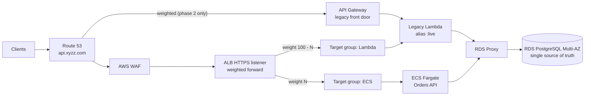

# Migration Strategy: API Gateway + Lambda → ALB + ECS Fargate + RDS

**Goal:** move the production order API with **zero customer-visible downtime, no lost
or duplicated orders, and a rollback that takes seconds at every step**.

**Approach:** a strangler-fig migration that changes **one variable at a time**:

1. Build the new platform next to the old one.
2. Put both stacks on **one shared database**.
3. Move the front door.
4. Shift traffic per request with weighted ALB target groups, measuring as we go.
5. Decommission only after a bake period.

---

## 1. Current architecture assessment

Before any change, I inventory the system and set the baseline we will judge the
migration against.

### 1.1 Inventory checklist

| Area | What to capture | Why it matters |
|---|---|---|
| **API Gateway** | REST vs HTTP API, routes, stages, custom domain + certificate, authorizers (Cognito / Lambda / IAM), API keys and usage plans, throttling, request validation, mapping templates, CORS, binary media types, payload sizes, WAF, access-log format | Every API Gateway feature in use must be rebuilt on ALB/app, or the cut-over silently changes behaviour |
| **Lambda** | Functions per route, runtime, memory, timeout, reserved / provisioned concurrency, env vars and secrets, layers, VPC config, IAM role, event sources besides API GW (SQS, EventBridge, S3), retries/DLQ/destinations, idempotency (e.g. Powertools + DynamoDB) | Hidden behaviour (async retries, idempotency stores, cron triggers) must be carried over or explicitly retired |
| **Database** | Engine/version, instance size, `max_connections`, extensions, how Lambda connects (direct vs proxy), credentials, backups/PITR, size and growth, write rate, long transactions, sequences | Determines the database migration path and the connection budget |
| **Traffic** | RPS by route (avg / peak / seasonality), payload sizes, p50/p95/p99 latency, error rates, top clients, retry behaviour, timeouts configured by clients | Becomes the **baseline SLO** for go/no-go gates |
| **Clients** | Web/mobile/partner integrations, SDK retry policies, hard-coded hostnames, IP allow-lists | Retries cause duplicates; pinned endpoints miss the DNS switch |
| **Operations** | Dashboards, alarms, runbooks, on-call, deployment process, change freezes, business peak windows | Migration steps must avoid peaks and be observable |

### 1.2 Baseline (example values to be replaced with measured data)

| Metric | Baseline (API GW + Lambda) | Gate for ECS |
|---|---|---|
| Availability (non-5xx) | 99.95% | ≥ baseline |
| p50 / p99 latency (POST /orders) | 120 ms / 900 ms (cold starts) | p99 ≤ baseline |
| p50 / p99 latency (GET /orders/{id}) | 40 ms / 600 ms | p99 ≤ baseline |
| 5xx rate | 0.05% | ≤ baseline + 0.1 pp |
| Peak RPS | 500 | Load-tested at 2× peak |
| DB connections at peak | 300 (Lambda concurrency) | < 60% of `max_connections` |

### 1.3 Assumptions

- The current database is **PostgreSQL**: an RDS instance reached by the Lambdas without a proxy.
  (§5.6 covers what changes if it is DynamoDB.)
- The API contract (paths, payloads, status codes) must not change for clients.
- The existing Lambda code can be changed slightly (accept ALB events, use RDS Proxy,
  honour `Idempotency-Key`).
- Separate AWS accounts per environment. Staging mirrors prod's topology and is used for
  every rehearsal.

## 2. Target architecture

See [architecture/ARCHITECTURE.md](architecture/ARCHITECTURE.md). The topology
**during** the migration:



Both stacks read and write **the same database through the same proxy**. There is
never a second writable copy of the data, so there is nothing to reconcile when traffic
moves back and forth.

## 3. Phased plan

Each phase has entry criteria, a reversible action, a bake time and exit gates. Nothing
runs during business peaks or change freezes.

| # | Phase | Action | Rollback | Bake |
|---|---|---|---|---|
| 0 | **Assess & prepare** | Inventory, baseline, contract tests, load tests, runbooks | n/a | n/a |
| 1 | **Build the platform** | Terraform: VPC, ALB, WAF, ECS (0 traffic), RDS Proxy, alarms. Deploy the FastAPI service | Destroy, no traffic | n/a |
| 2 | **Database consolidation** | Move the DB into the new VPC behind RDS Proxy (§5); point Lambda at the proxy | Reverse replication → point back | 3–7 days |
| 3 | **Dark launch** | ECS live in prod at weight 0; header-routed internal traffic, synthetic canaries, read replay | Nothing to roll back | 2–3 days |
| 4 | **Front-door move** | Lambda behind the ALB (Lambda target group = 100%); Route 53 weighted API GW → ALB 10 → 50 → 100% | Route 53 weight back to API GW | 2–3 days |
| 5 | **Canary to ECS** | ALB weights ECS 1 → 5 → 25 → 50 → 100% | ALB weight back to 0 (seconds) | per step, §7 |
| 6 | **Bake at 100%** | Lambda target group kept at weight 0 as a warm standby | Weight back (seconds) | 2 weeks |
| 7 | **Decommission** | Remove Lambda target group, API Gateway, old DB (after final snapshot), old alarms | Redeploy from IaC + snapshot | n/a |

Phases 2, 4 and 5 are separate on purpose: if errors appear we know whether the
database, the front door or the compute caused them.

## 4. Application changes

### 4.1 New service (this repository's `app/`)

| Concern | Lambda version | ECS version |
|---|---|---|
| Entry point | `handler(event, context)` behind API Gateway | FastAPI + Uvicorn (2 workers/task), same routes and payloads |
| Validation | API Gateway request validators / ad-hoc | Pydantic models, `extra="forbid"`, uniform `{"error": {...}}` envelope |
| DB connections | One per concurrent invocation | Bounded SQLAlchemy pool per worker, `pool_pre_ping`, fail-fast timeouts, RDS Proxy |
| Idempotency | e.g. Powertools idempotency in DynamoDB, or none | `Idempotency-Key` stored with the order under a UNIQUE constraint in the shared DB (§9) |
| Config / secrets | Lambda env vars | Env vars + Secrets Manager injection by ECS |
| Health | n/a (managed) | `/health` (liveness, used by ALB) + `/health/ready` (DB check) |
| Shutdown | n/a | SIGTERM → drain in-flight requests (25 s) before the 30 s `stopTimeout` |
| Logging | CloudWatch per function | Structured JSON, request id (`X-Request-ID` / `X-Amzn-Trace-Id`) in every line |
| Lambda-isms removed | `/tmp` caching, global state, `context.aws_request_id` | Nothing to remove; the container is long-lived and stateless |

### 4.2 Replacing API Gateway features

| API Gateway feature | Replacement |
|---|---|
| Authorizers (JWT/Cognito) | JWT validation middleware in the app (or ALB `authenticate-oidc` / Cognito action for browser flows) |
| Throttling / usage plans | WAF rate-based rules per IP (+ per API key header if partners use keys); app-level limits for business rules |
| Request validation | Pydantic |
| Mapping templates | Not needed (app returns the final JSON); verified by contract tests |
| CORS | Starlette `CORSMiddleware` with an explicit origin allow-list |
| Custom domain / TLS | ACM certificate on the ALB HTTPS listener |
| Max integration timeout 29 s | ALB idle timeout 60 s; the app enforces its own 5 s DB statement timeout |

### 4.3 Changes to the legacy Lambda (small, deployed in phase 2/4)

1. Connect through **RDS Proxy** (prevents the connection storm when both stacks run).
2. Accept **ALB events** as well as API Gateway events (ALB passes a slightly different
   event shape; Mangum / Powertools resolvers support both).
3. Honour the same **`Idempotency-Key`** semantics, **against the same table** as ECS.
   If the Lambda keeps its own idempotency store (e.g. DynamoDB), a retry that lands on
   the other stack is not recognised and creates a duplicate order.
4. Publish a version and a `live` alias; the ALB target points at the alias so a Lambda
   rollback is an alias flip.

### 4.4 Proving behavioural parity

- **Contract tests:** one black-box test suite (status codes, headers, JSON shapes,
  money formatting, timestamps in UTC with offset, error envelopes) runs against **both**
  stacks in staging. Run it via the ALB with the canary header (§7.1) and via API Gateway. Differences block the migration.
- **Read replay:** sampled production `GET` requests (from ALB/API GW access logs) are
  replayed against both stacks and responses diffed (no side effects).
- **Load test:** 2× peak RPS for 1 h on staging (k6 / Distributed Load Testing on AWS),
  plus a soak test, plus a failover test (reboot RDS with failover) during load.

## 5. Database migration

### 5.1 Principle: one writable database at all times

Both stacks share one database for the entire compute migration. **The application never dual-writes.**
Dual writes across two databases cannot be made consistent without distributed
transactions, and they would make every rollback a data-reconciliation project.

### 5.2 Path (current PostgreSQL → new RDS in the new VPC)

1. **Provision** the target RDS PostgreSQL (Terraform, Multi-AZ, same major version or
   newer) and RDS Proxy.
2. **Baseline the schema.** `pg_dump --schema-only` into the target. Then
   `alembic stamp 0001` so Alembic owns schema changes from now on, without re-creating
   existing tables.
3. **Replicate:** native PostgreSQL logical replication (publication on source,
   subscription on target) or **AWS DMS full load + CDC**. Every table needs a primary
   key; large tables are copied in parallel.
4. **Validate continuously:** row counts per table, checksums on recent partitions,
   DMS data validation, replication lag (`pg_stat_subscription` / DMS CDC latency) ≈ 0.
5. **Prepare reverse replication** (target → old source) so the old database stays a
   valid rollback target after cut-over.
6. **Cut-over, in a low-traffic window, scripted and rehearsed in staging:**
   1. Put writes into short maintenance: the API returns `503` + `Retry-After: 5` for
      writes. Reads continue. Clients retry with the same `Idempotency-Key`, so no order is lost or duplicated.
   2. Wait for replication lag = 0, then stop replication.
   3. **Reset sequences** on the target (logical replication/DMS do not move them):
      `SELECT setval(...)` from `max(id)` for every identity/serial column.
   4. Point the Lambda (and ECS) at the **RDS Proxy endpoint**. Use a version
      update/alias flip for Lambda, and a config change for ECS.
   5. Re-enable writes and start reverse replication.
   
   Expected write pause: **30–90 seconds**, invisible to clients that retry.
7. **Bake** 3–7 days with reverse replication running, then retire the old instance
   (final snapshot retained per the data-retention policy).

> If the existing database is already RDS PostgreSQL in the right account, steps 3–6 can
> be replaced by placing RDS Proxy in front of it and connecting it to the new VPC
> (peering / Transit Gateway). The VPC move then happens later, with the same
> replication pattern.

### 5.3 Schema changes during the migration: expand / contract only

Old Lambda code, new ECS code and the previous ECS revision all run against the same
schema at the same time. Every change must be backward compatible:

1. **Expand:** add nullable columns or new tables, and back-fill in batches.
2. **Migrate:** deploy code that writes both shapes and reads the new one.
3. **Contract:** drop old columns only after every reader is gone (after decommission).

Migrations run as a one-off ECS task before the service update, with
`lock_timeout = 5s` so a migration never blocks live traffic waiting for a lock (see
[`app/migrations/env.py`](app/migrations/env.py)).

### 5.4 Data consistency

- **Single source of truth.** Consistency comes from the design, not from reconciliation.
- **Transactions:** an order and its items are inserted in one transaction. The
  idempotency key is part of the same row, so an order cannot exist without its key.
- **Constraints in the database, not only in code:** `UNIQUE(idempotency_key)`,
  `CHECK(quantity > 0)`, `CHECK(unit_price > 0)`, FK with cascade. Both stacks are bound by them.
- **Identical semantics:** contract tests pin money as decimal strings, timestamps as UTC
  with offset, and status values, so a client cannot tell which stack served it.
- **No per-stack caches** of order data during the migration (a cache populated by one
  stack would serve stale data after a write through the other).
- **Reconciliation job** (EventBridge Scheduler → Lambda, hourly during migration):
  detects suspected duplicates (same customer, same payload fingerprint within 2 min),
  orphan items, and order counts by stack vs ALB request counts.

### 5.5 Connection budget during coexistence

```
Lambda concurrency (reserved: 100) ─┐
ECS: 30 tasks × 2 workers × 10 ─────┼─► RDS Proxy (≤ 80% of max_connections) ─► RDS
Migrations / ops / DMS ─────────────┘
```

Without the proxy, `100 + 600 + ops` client connections would exceed `max_connections`
of most instance classes (the exact failure in [MIGRATION_INCIDENT.md](MIGRATION_INCIDENT.md)).

### 5.6 If the current store is DynamoDB instead

The pattern stays the same, with different tools:

- **Export to S3 + DynamoDB Streams** → transform → load into PostgreSQL, with the stream
  as CDC.
- During coexistence, run **one writer**: ECS writes to PostgreSQL and a stream-based
  replicator keeps DynamoDB updated for the Lambda readers, until Lambda is retired.
- Or keep DynamoDB as the store and have ECS use it. Changing the database is not
  required to change the compute.

## 6. Load balancing

| Setting | Value | Reason |
|---|---|---|
| Algorithm | `least_outstanding_requests` | Slow tasks/Lambda get fewer new requests |
| Targets | `ip` (Fargate ENIs) + `lambda` target group during migration | Weighted forward action splits per request |
| Health check | `GET /health`, 10 s interval, 2 healthy / 3 unhealthy | Shallow, so DB issues do not deregister every task |
| Slow start | 30 s | New tasks warm up (connection pool, JIT caches) before full load |
| Deregistration delay | 30 s | In-flight requests finish; < ECS stopTimeout |
| Stickiness (migration only) | Target-group stickiness, 1 h | A client stays on one stack during the canary, which keeps its experience consistent and makes per-stack analysis cleaner |
| Idle timeout vs keep-alive | 60 s vs 75 s | Avoids 502s from the ALB reusing a connection the app closed |

## 7. Traffic migration

### 7.1 Dark launch (phase 3)

- ECS target group at **weight 0**. An extra listener rule routes requests with an internal header (e.g.
  `X-Orders-Canary: ecs`, allowed only from the office/VPN IP set or with a secret value)
  to ECS, so engineers and synthetic canaries can test ECS in production with real
  data, real network and real IAM before any customer traffic. This is implemented as
  the `canary_routing` input of [`terraform/modules/alb`](terraform/modules/alb/main.tf).

### 7.2 Front-door move (phase 4)

API Gateway and the ALB both serve the hostname with the same ACM certificate. The ALB
initially sends **100% to the Lambda target group**, so only the front door changes:

- Lower the TTL of `api.xyzz.com` to 60 s **48 h in advance**.
- Route 53 **weighted records**: API GW 90 / ALB 10 → 50/50 → 0/100 over 2–3 days.
- Watch for clients that ignore DNS TTLs (long-lived JVM/mobile caches) via API Gateway
  request counts. API Gateway stays deployed until its traffic is ~0 for 7 days.

### 7.3 Canary to ECS (phase 5)

Change one Terraform variable (`ecs_traffic_weight`), or in an emergency one
`aws elbv2 modify-listener` call. **Per request, instant, no DNS caching.**

| Step | ECS weight | Minimum bake | Must include |
|---|---|---|---|
| 1 | 1% | 2 h | Business-hours traffic |
| 2 | 5% | 24 h | A daily peak |
| 3 | 25% | 24 h | A daily peak + nightly batch window |
| 4 | 50% | 48 h | Two peaks |
| 5 | 100% | 2 weeks (phase 6) | A weekly peak; Lambda kept warm at weight 0 |

**Promotion gates (all must hold, compared per target group, ECS vs Lambda):**

- 5xx rate ≤ Lambda's + 0.1 pp
- p99 latency ≤ Lambda's (per route)
- Zero suspected duplicates in the reconciliation job
- No new error signatures in logs
- RDS connections < 60% of `max_connections`, CPU < 60%
- No ECS task restarts, OOM kills or deployment rollbacks

**Automatic stop conditions** are in [MIGRATION_INCIDENT.md §7](MIGRATION_INCIDENT.md#7-conditions-that-stop-the-migration).

## 8. DNS strategy

| Item | Decision |
|---|---|
| Record type | Route 53 **alias** A/AAAA → ALB (health-evaluated, free queries, no IP management) |
| TTL | Lowered to 60 s 48 h before the front-door move; raised again (300 s) after decommission |
| Front-door move | Weighted records API GW ↔ ALB (coarse, minutes to converge, so used only for the front door) |
| Canary | **Not DNS.** ALB weights instead: precise, per request, immediate rollback |
| Certificates | Same hostname on API GW custom domain and ALB (ACM, DNS-validated) during overlap |
| Stragglers | API Gateway kept until its request count is ~0 for 7 days; then the custom domain is removed |
| Internal names | Services use the RDS Proxy endpoint name, not instance endpoints, so DB moves don't need app changes |

## 9. Duplicate requests

### 9.1 Why duplicates appear during a migration

1. **Client retries after timeouts:** the first request committed, but the client gave up
   (latency increased on the new stack, or the timeouts differ: API GW 29 s vs ALB 60 s).
2. **Retries landing on the other stack:** with weighted routing, a retry can be served by
   a stack that doesn't know about the first attempt's idempotency record.
3. **5xx after commit:** the app commits and then fails to respond (crash, 502 from a
   keep-alive race, task stopped mid-response).
4. **At-least-once delivery** in async paths (SQS, Lambda async retries, EventBridge).
5. **Double submits** from users or front-end bugs.

### 9.2 Controls

| Control | Where | Status |
|---|---|---|
| `Idempotency-Key` header; key + request fingerprint stored **on the order row**, **UNIQUE** constraint, same transaction | API (both stacks, shared DB) | Implemented in `app/` ([`service.py`](app/orders_api/service.py)), with tests including the concurrent-race case |
| Same key + same body → original order (`200`, `Idempotent-Replayed: true`); same key + different body → `422` | API | Implemented |
| `REQUIRE_IDEMPOTENCY_KEY=true` once clients send keys | API config | Implemented (enabled in staging) |
| Clients generate one key per checkout attempt, retry only with the same key, exponential backoff + jitter, honour `Retry-After` | Client SDKs | Client change |
| Timeouts ordered client < ALB < app keep-alive; proxies never auto-retry POST | Infra | Configured |
| Graceful shutdown + deregistration delay, so tasks don't die mid-response | ECS/ALB | Configured |
| Idempotent consumers (dedupe on message id / business key) for SQS/Lambda workers | Workers | Design rule |
| Reconciliation job for suspected duplicates | Ops | Migration runbook |

## 10. Rollback strategy

Because there is a single database, **every rollback is a routing change, never a data
change**.

| Phase | Trigger | Rollback action | Time to effect |
|---|---|---|---|
| 2: DB move | Errors, replication issues, perf regression | Pause writes, point Lambda back to the old DB (reverse replication keeps it current), resume | Minutes |
| 4: Front door | Error/latency regression on the ALB path | Route 53 weight back to API Gateway | TTL (60 s) + client caches |
| 5: Canary | Any stop condition | `ecs_traffic_weight = 0` (Terraform) or `aws elbv2 modify-listener` (break-glass, recorded in the incident) | Seconds |
| 5: Bad ECS release | Alarm / circuit breaker | ECS auto-rollback to previous task definition; or redeploy previous image | 2–5 min |
| 6: Bake | Late regression | Weight back to Lambda (still warm, still deployed) | Seconds |
| 7: After decommission | Severe regression | Redeploy Lambda + target group from IaC (kept in git history for 90 days) | Hours (hence the 2-week bake) |

Rollbacks are **rehearsed in staging** before each production phase (game day), and the
commands are in the runbook, ready to paste.

## 11. Monitoring during migration

A dedicated **"Migration" CloudWatch dashboard** shows both stacks side by side:

| Signal | Lambda path | ECS path |
|---|---|---|
| Traffic | ALB `RequestCount` per target group | ALB `RequestCount` per target group |
| Errors | `HTTPCode_Target_5XX_Count` (Lambda TG), Lambda `Errors`, `Throttles` | `HTTPCode_Target_5XX_Count` (ECS TG), app ERROR log metric |
| Latency | `TargetResponseTime` p50/p99 (Lambda TG), Lambda `Duration` | `TargetResponseTime` p50/p99 (ECS TG) |
| Saturation | `ConcurrentExecutions` | ECS CPU/memory, running tasks |
| Database | `DatabaseConnections`, proxy `ClientConnections` / `DatabaseConnectionsBorrowLatency` / `DatabaseConnectionsCurrentlySessionPinned`, Performance Insights top waits, `pg_stat_activity` grouped by `application_name` | same |
| Business | Orders created per minute **by stack**, suspected duplicates (reconciliation), payment/fulfilment failures | same |

Also during the migration:

- **Tighter alarm thresholds**, routed to the migration channel and on-call.
- **Synthetic canaries** (CloudWatch Synthetics) every minute through both paths.
- **Deployment annotations** on dashboards for every weight change.
- **Staffing:** a named owner and a second engineer are on the call during each weight
  change, with a go/no-go checklist and a pre-written status-page update.

## 12. Post-migration validation

| Area | Checks |
|---|---|
| Functional | Contract suite green against prod; smoke tests; end-to-end order flow including async side effects |
| Data | Row counts and checksums vs source (DB move); zero unexplained duplicates; no orphan items; sequences ahead of max ids |
| Performance | p50/p99 per route ≤ baseline; load test at 2× peak passes on prod-sized staging |
| Resilience | RDS failover test and AZ-evacuation test (staging) under load; ECS task kill test |
| Security | No public DB (Config rule + Network Access Analyzer); WAF logging; Checkov/Trivy green; IAM Access Analyzer findings reviewed |
| Operations | Alarms proven to fire (inject failures); runbooks updated; on-call trained; dashboards replace the old ones |
| Cost | Compare 2 weeks of CUR data vs the Lambda baseline; apply Savings Plans to the new baseline |
| Decommission | Lambda target group, API Gateway stage/domain, Lambda functions, old IAM roles, old DB (final snapshot kept), old log groups (archived), DNS weights, stale alarms. Verify each with zero traffic for 7 days first |

## 13. Indicative timeline

| Week | Work |
|---|---|
| 1 | Assessment, baseline, contract tests, Terraform for all environments |
| 2 | Service hardening, load tests, staging rehearsal of DB move and rollbacks |
| 3 | Phase 2 (DB consolidation) in prod, bake |
| 4 | Phases 3–4 (dark launch, front door), bake |
| 5–6 | Phase 5 canary 1% → 100% |
| 7–8 | Phase 6 bake, phase 7 decommission |
