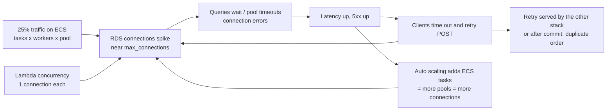

# Migration Incident Analysis: 75% Lambda / 25% ECS

**Situation:** the canary is at **25% ECS / 75% Lambda** (ALB weighted target groups,
shared RDS PostgreSQL). Shortly after the step from 5% to 25%:

- API latency increases
- 5xx errors increase
- RDS connections increase significantly
- Some users report **duplicate requests/orders**

## TL;DR

1. **Duplicate orders are a data-integrity incident. Contain first, then investigate.**
   I set the ECS weight back to **0%** right away (one ALB listener change, effective in
   seconds). The database is shared and nothing has to be migrated back, so rolling back costs
   nothing. That is exactly why the migration was designed this way.
2. ECS stays **running at 0% weight**, reachable via the canary header, so we can reproduce
   the problem with synthetic traffic instead of customers.
3. The symptoms form one feedback loop, and I would confirm it with the evidence below:
   **connection pressure on RDS → slow queries / pool timeouts → latency and 5xx →
   client retries → duplicate orders (retries crossing stacks are not deduplicated) →
   more load and more connections.**
4. The migration is **paused**, not cancelled. It resumes at 5% only after the fixes are
   verified in staging under load.



---

## 1. What I would investigate first

The first 10 minutes cover impact, containment and correlation, in that order:

| # | Question | How |
|---|---|---|
| 1 | **How bad, and is it getting worse?** Error rate, latency, orders/minute vs normal, number of duplicate reports | Migration dashboard; support ticket count |
| 2 | **Contain:** set ECS weight → 0, announce in the incident channel, status page if customer-visible | `aws elbv2 modify-listener` (runbook) or `ecs_traffic_weight = 0` |
| 3 | **Did containment work?** Errors and latency should recover within minutes. If they do **not**, the cause is shared (DB, proxy, network), not ECS alone | Same dashboard |
| 4 | **Which stack is failing?** Compare per target group: 5xx, latency. Are Lambda requests also slower (shared DB contention) or only ECS? | ALB metrics per target group |
| 5 | **What changed, and when?** Weight change timestamp vs onset; any ECS deploy, config change, auto scaling event, DB maintenance, client release | Deployment annotations, CloudTrail, ECS service events |
| 6 | **Who holds the DB connections?** | `pg_stat_activity` grouped by `application_name` (query below) |
| 7 | **Are duplicates real, and how many?** | Duplicate-detection SQL (below) |

## 2. AWS metrics and logs to check

### 2.1 Metrics

| Layer | Metric | What it tells me |
|---|---|---|
| ALB (per target group) | `HTTPCode_Target_5XX_Count` vs `HTTPCode_ELB_5XX_Count` | Errors from the app vs the load balancer (502/503/504) |
| ALB (per target group) | `TargetResponseTime` p50/p99, `RequestCount`, `TargetConnectionErrorCount` | Which stack is slow; connection failures to targets |
| ALB | `RejectedConnectionCount`, `HTTPCode_ELB_504_Count` | Saturation; requests exceeding the idle timeout |
| ECS / Container Insights | `CPUUtilization`, `MemoryUtilization`, `RunningTaskCount`, task restarts | Task saturation, OOM kills, scaling activity |
| Auto Scaling | Scaling activities on the service | Did scaling out **add** connection pools during the incident? |
| Lambda | `Errors`, `Throttles`, `Duration`, `ConcurrentExecutions` | Lambda side slowing down from shared contention; concurrency (= connections) rising |
| RDS | `DatabaseConnections`, `CPUUtilization`, `ReadLatency`/`WriteLatency`, `DiskQueueDepth`, `FreeableMemory` | Connection saturation vs CPU vs I/O |
| RDS Performance Insights / Database Insights | DB load by **wait event** and **top SQL** | `Client:ClientRead`, `LWLock`, `Lock:transactionid`, `IO:DataFileRead`; which statements |
| RDS Proxy | `ClientConnections`, `DatabaseConnections`, `DatabaseConnectionsBorrowLatency`, **`DatabaseConnectionsCurrentlySessionPinned`**, `QueryDatabaseResponseLatency` | Is the proxy multiplexing, or are sessions pinned (proxy degenerating into 1:1)? Is borrow latency the bottleneck? |
| WAF | Blocked / rate-limited requests | Retry storms tripping the rate limit (looks like 403s to users) |

### 2.2 Logs and queries

**CloudWatch Logs Insights, ECS application (JSON logs):**

```sql
-- Error classes on ECS over time
fields @timestamp, status, route, message, exception
| filter level = "ERROR" or status >= 500
| stats count(*) as errors by bin(1m), status, route
| sort bin(1m) desc

-- Pool exhaustion / DB unavailability signatures
fields @timestamp, message, exception
| filter message like /database unavailable/ or exception like /QueuePool limit|TimeoutError|too many clients|remaining connection slots/
| stats count(*) by bin(1m)

-- Latency by route (p99) on ECS
filter message = "request completed"
| stats pct(duration_ms, 99) as p99, count(*) as n by route, bin(5m)
```

**ALB access logs in S3, via Athena:** per-request truth across both stacks:

```sql
-- 5xx by target group and who generated them
SELECT date_trunc('minute', from_iso8601_timestamp(time)) AS minute,
       target_group_arn, elb_status_code, target_status_code, count(*) AS n
FROM alb_logs
WHERE day = '2026/10/12' AND elb_status_code >= 500
GROUP BY 1, 2, 3, 4 ORDER BY 1;

-- Retries: same client POSTing /orders several times within 60 s, and on which stack
SELECT client_ip, user_agent, count(*) AS attempts,
       array_agg(DISTINCT target_group_arn) AS stacks,
       array_agg(elb_status_code) AS statuses
FROM alb_logs
WHERE request_verb = 'POST' AND request_url LIKE '%/orders%'
GROUP BY client_ip, user_agent, date_trunc('minute', from_iso8601_timestamp(time))
HAVING count(*) > 1;
```

`target_processing_time = -1` means the target never answered (timeout/reset). A first
attempt with `-1` or 5xx followed by a successful retry is the duplicate signature.

**Lambda:** CloudWatch Logs Insights on the function's log group for connection errors
(`too many clients`, `timeout`), plus `REPORT` lines for duration and init (cold
starts).

**Database (run on the primary, read-only queries):**

```sql
-- Who holds the connections, and in what state
SELECT application_name, usename, state, count(*) AS connections,
       max(now() - state_change) AS longest_in_state
FROM pg_stat_activity
WHERE datname = 'orders'
GROUP BY 1, 2, 3 ORDER BY connections DESC;

-- Long-running or idle-in-transaction sessions holding locks
SELECT pid, application_name, state, now() - xact_start AS xact_age, wait_event_type, wait_event,
       left(query, 120) AS query
FROM pg_stat_activity
WHERE xact_start IS NOT NULL ORDER BY xact_age DESC LIMIT 20;

-- Top statements by total time since reset (pg_stat_statements is preloaded)
SELECT calls, round(total_exec_time) AS total_ms, round(mean_exec_time, 1) AS mean_ms, left(query, 120)
FROM pg_stat_statements ORDER BY total_exec_time DESC LIMIT 15;

-- Suspected duplicate orders: same customer and same total within 2 minutes
SELECT a.customer_id, a.id AS first_order, b.id AS duplicate, a.total_amount,
       a.created_at, b.created_at, a.idempotency_key, b.idempotency_key
FROM orders a JOIN orders b
  ON a.customer_id = b.customer_id AND a.total_amount = b.total_amount
 AND b.created_at > a.created_at AND b.created_at < a.created_at + interval '2 minutes'
WHERE a.created_at > now() - interval '6 hours';
```

The ECS service sets `application_name = orders-api-<env>`. The Lambda is changed to set
`orders-lambda`, so the first query attributes connections to a stack immediately.

## 3. How I would identify the root cause

I treat each explanation as a hypothesis and look for evidence that **discriminates**
between them, not just evidence that fits:

| Hypothesis | Confirming evidence | Ruling-out evidence |
|---|---|---|
| **H1: Connection exhaustion.** ECS pools (`tasks × workers × (pool + overflow)`) plus Lambda's one-connection-per-invocation exceed what RDS / the proxy can serve. Auto scaling makes it worse: latency → more tasks → more pools | `DatabaseConnections` near `max_connections`; `too many clients` / `remaining connection slots` in logs; pool `TimeoutError` on ECS; Lambda connect errors; connections by `application_name` dominated by idle ECS pools; scale-out events right before the spike | Connections well below max and DB waits not on connection acquisition |
| **H2: Duplicates from non-idempotent retries.** Clients retry POST after timeouts/5xx; the first attempt had committed. The retry often lands on **the other stack** (25/75 split) | Duplicate pairs with **different or missing idempotency keys**, seconds apart; ALB logs show the first attempt as 5xx/504/`-1` and the retry on another target group; Lambda's idempotency stored elsewhere (e.g. DynamoDB) or not implemented | Duplicates share the same idempotency key → would point to a bug in the dedupe itself |
| **H3: Proxy not multiplexing (session pinning).** Something the app does at connect time (startup `options`, `SET` statements, temporary tables, advisory locks) pins every client to its own DB connection | `DatabaseConnectionsCurrentlySessionPinned` ≈ `ClientConnections`; proxy borrow latency rising | Pinned count ≈ 0 |
| **H4: Slow queries / lock contention introduced by ECS code.** Missing index, N+1 queries, longer transactions than the Lambda code | Performance Insights top SQL from `orders-api`; `Lock:transactionid` waits; idle-in-transaction sessions; higher DB time per request on ECS | DB load per query unchanged; waits are on connections, not locks/IO |
| **H5: ECS under-provisioned or mis-tuned.** CPU throttling, too few workers, threadpool saturation, OOM restarts | ECS CPU > 85%, task restarts, `TargetResponseTime` high on ECS TG while DB is healthy | ECS CPU/memory low during the incident |
| **H6: Infrastructure misconfiguration.** Keep-alive < ALB idle timeout (502s), health-check flapping, missing SG rule to the proxy for some tasks | 502s with `target_status_code = -`; targets flapping in `describe-target-health`; errors only on some AZs/tasks | Errors spread evenly, no flapping |

**Most likely chain:** H1 + H2, possibly amplified by H3. Moving from 5% to 25% multiplied
ECS connection pools, while Lambda still opened connections per invocation. RDS ran out
of connections, both stacks slowed down, clients retried, and the retries were not
deduplicated across stacks.

**Confirming it in a controlled way:** reproduce in staging (or in prod via the canary
header at low volume) with the same task count and Lambda concurrency, watch
`pg_stat_activity` per `application_name`, and confirm that capping pools and routing Lambda
through the proxy flattens the curve. The root cause is confirmed when we can switch it
on and off.

## 4. Continue, pause or roll back?

**Decision: roll the traffic back (ECS weight → 0%) immediately, and pause the
migration.** Do not roll back the database or tear down ECS.

| Option | When it is right | Here |
|---|---|---|
| **Continue** | Errors within gates, cause understood, no data impact | ❌ Error gates breached and data is wrong |
| **Pause** (hold at 25%) | Minor regression, well understood, no customer/data harm, fix imminent | ❌ Duplicate orders are customer and financial harm; holding keeps creating them |
| **Roll back traffic** (weight → 0) | Any data integrity issue or SLO breach with unknown cause | ✅ Seconds to effect, zero data migration, ECS stays deployed for diagnosis |
| **Full rollback** (remove ECS, revert DB move) | The platform itself is unsound | ❌ Not justified: the DB move baked fine and the issue is triggered by the canary step |

If the metrics do **not** recover at 0% ECS, the problem is shared. In that case I would
look at the database, the proxy and the Lambda change deployed for the migration, and
consider rolling back the Lambda alias to the previous version.

**Restart criteria:** fixes merged and verified in staging with a load test at
2× peak including the 25% split; connection budget proven (< 60% of max); duplicate
reconciliation clean; then restart at 5% with a longer bake.

## 5. Preventing duplicate requests

**Immediate (incident):**

- Identify duplicates (query above), hand the list to the business for cancellation or
  refund through the normal order process (never delete rows by hand), and keep an
  audit trail.

**Permanent:**

1. **One idempotency mechanism for both stacks, in the shared database.** The
   `Idempotency-Key` is stored on the order row under a `UNIQUE` constraint in the same
   transaction (implemented in [`app/orders_api/service.py`](app/orders_api/service.py),
   including the concurrent-race case). The Lambda is changed to use the **same table and
   semantics**, so it doesn't matter which stack a retry lands on.
2. **Make the key mandatory** (`REQUIRE_IDEMPOTENCY_KEY=true`) once client releases send
   it; clients create one key per checkout attempt and reuse it on every retry.
3. **Client retry policy:** retry only idempotent requests or requests with a key;
   exponential backoff with jitter; honour `Retry-After` (the API returns it with 503);
   cap attempts. Front ends disable the submit button while a request is in flight.
4. **Timeout ordering:** client timeout > typical p99. The server fails fast (3 s pool
   wait, 5 s statement timeout) with a 503 instead of letting the client time out
   after the order was committed.
5. **No retries by intermediaries on POST.** The ALB does not retry; no proxy or SDK
   layer adds hidden retries.
6. **Detection:** the reconciliation job alarms on any suspected duplicate during the migration.

## 6. Maintaining data consistency

- **Single writable database.** Both stacks write to one PostgreSQL through one proxy;
  there is no dual-write or cross-database sync to diverge. Rolling traffic back and
  forth never needs data movement.
- **Atomicity:** an order, its items and its idempotency key are committed in one
  transaction; a failure leaves nothing behind.
- **Database-enforced invariants:** unique idempotency key, check constraints, foreign
  keys. They protect against bugs in either code base.
- **Backward-compatible schema only** (expand/contract) while two code bases share it.
- **No stack-local caches** of mutable order data during the migration.
- **Fail closed:** when the DB is unavailable the API returns 503. It never "accepts" an
  order it cannot persist, and never queues it in memory.
- **Clean-up and audit:** duplicates found during the incident are resolved through the
  business process, then reconciliation runs again until it reports zero.

## 7. Conditions that stop the migration

**Hard stop: roll ECS weight back to 0 immediately** (automatable via an alarm-driven
runbook):

| Condition | Threshold |
|---|---|
| Any **data integrity** issue | ≥ 1 confirmed duplicate, lost or corrupted order |
| ECS 5xx rate | > Lambda's + 0.5 pp for 5 minutes |
| ECS p99 latency | > 1.5 × Lambda's p99 for 10 minutes |
| Error-budget burn rate | > 10× (1-hour window) |
| RDS connections | > 80% of `max_connections` |
| RDS CPU | > 80% for 10 minutes |
| ECS health | Deployment circuit breaker triggered, or tasks restarting / OOM |
| Security | Any security finding on the new path (WAF bypass, exposed endpoint, IAM issue) |

**Pause: hold the current weight and investigate:**

- A new error signature that is not understood, even at low volume
- Support tickets or customer complaints attributable to the new stack
- Metrics within gates but trending the wrong way during the bake
- Missing observability (a dashboard or alarm not working is itself a reason to stop)
- Operational: a business peak or change freeze approaching, or the on-call/owner unavailable

## 8. Follow-up

Blameless post-incident review within 3 business days, covering the timeline, detection
gap (why the alarms did not stop the step automatically), the contributing factors
above, and action items with owners:

1. RDS Proxy for both stacks (Lambda had connected directly).
2. Fix session pinning if found (move `statement_timeout` to the DB role).
3. Explicit connection budget alarm.
4. Unified idempotency.
5. Mandatory keys.
6. An automated stop condition that resets the weight when the 5xx/latency alarms fire during a canary step.
7. Longer bake at 5%.
8. A staging load test of every canary step before running it in prod.
